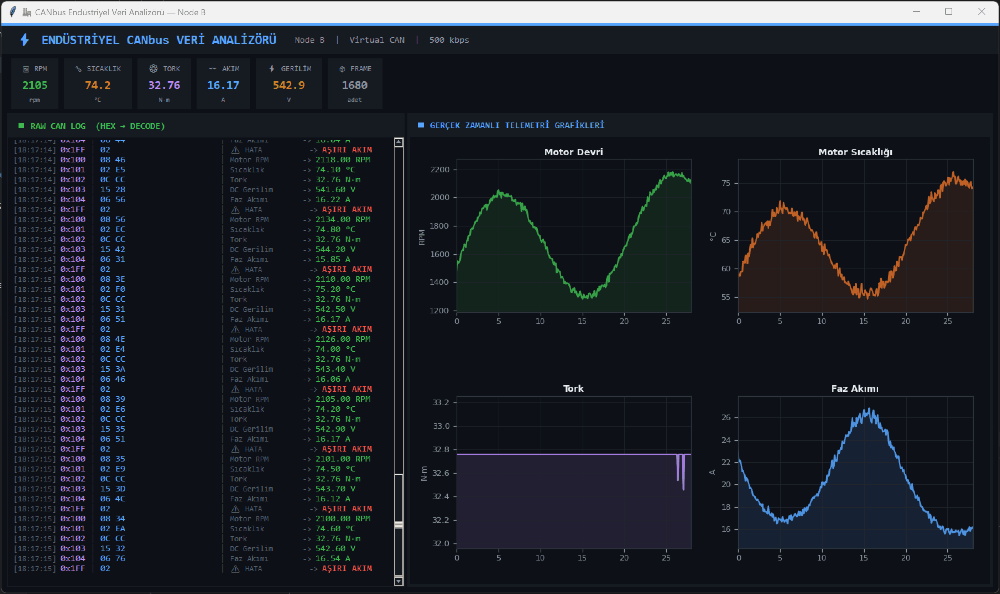

# 🏭 Industrial CANbus Data Analyzer

> **Zero-hardware industrial CAN bus simulation & real-time decoder**  
> Two Python nodes communicate over a virtual CAN network — raw hex frames decoded live into engineering units.

   


## 📌 What This Project Does




Machines on a factory floor speak in hex. This tool decodes that language in real time.

```
Raw CAN traffic (what the bus sees):
  [0x100]  05 DC
  [0x101]  02 F3
  [0x102]  12 5E

Decoded output (what an engineer needs):
  0x100 | 05 DC | Motor RPM      →  1500.00 RPM  ✓
  0x101 | 02 F3 | Temperature    →  75.50 °C     ✓
  0x102 | 12 5E | Torque         →  47.50 N·m    ✓
```

**Node A** mimics a motor drive, broadcasting telemetry every 100 ms.  
**Node B** listens, decodes every frame, and renders them in a real-time dashboard.

---

## 🏗 Architecture

```text
┌────────────────────────────────────────────────────────────────────────┐
│                      Virtual Industrial Network                        │
│                     (UDP Multicast · 239.0.0.1)                        │
├──────────────────────┬────────────────────────┬────────────────────────┤
│      NODE A          │        NODE B          │        NODE C          │
│  Motor Simulator     │ Analyzer + Dashboard   │ ML Anomaly Detector    │
│                      │                        │                        │
│  • Sine-wave RPM     │ ┌────────┬─────────┐   │ • Listens to telemetry │
│  • Thermal model     │ │HEX LOG │ GRAPHS  │   │ • Isolation Forest     │
│  • Torque from P=kW  │ └────────┴─────────┘   │ • Predicts anomalies   │
│  • Error flags       │ Thread-safe DataStore  │ • Broadcasts 0x200     │
│  10 frames / sec     │ 200 ms GUI refresh     │ Real-time ML Engine    │
└──────────────────────┴────────────────────────┴────────────────────────┘
```

### Thread Model
```
Main Thread  ──┬── tkinter event loop
               │   ├── _update_log()     every 200 ms
               │   ├── _update_graphs()  every 200 ms
               │   └── _update_kpis()    every 500 ms
               │
Daemon Thread ─└── can_listener_thread()
                    └── bus.recv() → DataStore → log_queue
```

---

## 📡 CAN Protocol Design

### Signal Map

| CAN ID | Signal | Type | Scale | Unit | Example Hex | Decoded |
|--------|--------|------|-------|------|-------------|---------|
| `0x100` | Motor RPM | uint16 BE | ×1 | RPM | `05 DC` | 1500 RPM |
| `0x101` | Temperature | int16 BE | ÷10 | °C | `02 F3` | 75.5 °C |
| `0x102` | Torque | int16 BE | ÷100 | N·m | `12 5E` | 47.50 N·m |
| `0x103` | DC Bus Voltage | uint16 BE | ÷10 | V | `15 8E` | 554.2 V |
| `0x104` | Phase Current | int16 BE | ÷100 | A | `08 34` | 20.84 A |
| `0x1FF` | Fault Flags | bitmask | — | — | `03` | OVERHEAT + OVERCURRENT |
| `0x200` | ML Anomaly Flag | uint8 | — | — | `01` | ML Anomali Tespit Edildi! |

> **Why Big-Endian?** Industrial protocols (CANopen, J1939, EtherCAT) all use big-endian byte ordering. This project follows the same convention for authenticity.

### Fault Bitmask

```
Bit 4    Bit 3    Bit 2    Bit 1    Bit 0
  │        │        │        │        └── Overheat      (T > 80 °C)
  │        │        │        └─────────── Overcurrent   (I > 5 A)
  │        │        └──────────────────── Undervoltage  (V < 520 V)
  │        └───────────────────────────── Comm Loss
  └────────────────────────────────────── Encoder Fault
```

---

## ⚙️ Motor Physics Model (Node A)

| Parameter | Formula | Range |
|-----------|---------|-------|
| **RPM** | `1500 + sin(t·0.3)·0.5 × 850 + N(0,15)` | 800 – 2500 RPM |
| **Temperature** | `25 + (RPM/2500)·55 + sin(t·0.05)·3` | 35 – 85 °C |
| **Torque** | `(P·60) / (2π·RPM)` , P = 7.5 kW | ~47 N·m @ 1500 RPM |
| **Current** | `Torque / Kt` , Kt = 2.1 | ~22 A @ full load |
| **Voltage** | `550 + sin(t·0.15)·8 + N(0,1)` | 540 – 560 V |

---

## 🧪 Encode / Decode Verification

| Signal | Input | Raw Hex | Decoded | Status |
|--------|-------|---------|---------|--------|
| RPM | 1500 | `05 DC` | 1500.00 RPM | ✅ Pass |
| Temperature | 75.5 °C | `02 F3` | 75.50 °C | ✅ Pass |
| Torque | 47.85 N·m | `12 5E` | 47.85 N·m | ✅ Pass |
| Single fault | OVERHEAT | `01` | "OVERHEAT" | ✅ Pass |
| Combined fault | OVERHEAT + OVERCURRENT | `03` | 2 faults | ✅ Pass |

---

## 🗂 Project Structure
```text
CANbus_Analyzer/
├── can_protocol.py          # CAN ID map, encode/decode engine, dataclasses
├── node_a_sender.py         # Motor simulator — physics model + Rich terminal
├── node_b_analyzer_gui.py   # CAN listener + tkinter/matplotlib dashboard
├── node_c_ml_anomaly_detector.py # ML Anomaly detection engine (Isolation Forest)
├── requirements.txt
└── README.md
```

---

## 🚀 Quick Start

### 1. Install dependencies
```bash
pip install -r requirements.txt
```

### 2. Start the Network

**Terminal 1 — start the analyzer first:**
```bash
python node_b_analyzer_gui.py
```

**Terminal 2 — start the simulator:**
```bash
python node_a_sender.py
```

### 3. Machine Learning (Anomaly Detection)

**Terminal 3 — Train the model (Wait 15 seconds):**
```bash
python node_c_ml_anomaly_detector.py --train
```

**Terminal 3 — Run real-time Inference:**
```bash
python node_c_ml_anomaly_detector.py
```

Within seconds, hex frames appear in the log panel, the ML node starts evaluating the data, and anomalies will trigger a `CAN_ID_ML_ANOMALY` message, rendering a red warning in the dashboard!

---

## 🛠 Tech Stack

| Library | Version | Purpose |
|---------|---------|---------|
| `python-can` | 4.6.1 | CAN bus abstraction layer |
| `tkinter` | stdlib | Main GUI window |
| `matplotlib` | 3.8+ | Real-time subplot graphs (TkAgg backend) |
| `rich` | 13.7+ | Colored terminal output (Matrix effect) |
| `numpy` | 1.26+ | Array operations, time-window masking |
| `scikit-learn` | 1.3+ | Isolation Forest Anomaly Detection |
| `pandas` | 2.0+ | Data manipulation for ML features |
| `msgpack` | 1.1.2 | UDP multicast serialization |
| `struct` | stdlib | Byte-level encode / decode |
| `threading` | stdlib | CAN listener daemon thread |
| `collections.deque` | stdlib | Fixed-size circular data buffer |

---

## 🔑 Key Engineering Decisions

| Decision | Reasoning |
|----------|-----------|
| `udp_multicast` over `virtual` bus | `virtual` is process-scoped — it cannot cross process boundaries. `udp_multicast` enables real socket communication between two independent processes, the same way a physical CAN adapter would. |
| `try / finally` in every update loop | Any matplotlib or tkinter exception must not prevent `root.after()` from rescheduling. Without `finally`, one draw error silently kills the entire update loop. |
| Dataclass for decoded frames | Clean separation between raw bytes and application-level values; makes extending to new CAN IDs trivial. |
| Big-Endian byte order | Matches CANopen / J1939 / EtherCAT industry standards. |
| Machine Learning Node (C) | Isolated ML logic into a separate node ensures the dashboard doesn't block on heavy inference, strictly adhering to Microservices / Node-based architecture (ideal for ROS2). |

---

## 🗺 Roadmap

| Priority | Feature | Approach |
|----------|---------|---------|
| 🟢 Done | Anomaly detection | `IsolationForest` (scikit-learn) via `node_c_ml_anomaly_detector.py` |
| 🔴 High | ROS2 Integration | Publish CAN data and ML Anomalies as custom ROS2 messages (`custom_msgs`) |
| 🟡 Medium | Real USB-CAN adapter | `interface='socketcan'` / `'kvaser'` / `'pcan'` |
| 🟡 Medium | Log recording & replay | ASC / CSV format via `python-can` built-ins |
| 🟡 Medium | DBC file parsing | [`cantools`](https://github.com/eerimoq/cantools) library |
| 🟢 Low | Web dashboard | FastAPI + WebSocket + Chart.js |

---

## 📄 License

MIT — free to use, modify, and distribute.

---

*"Turning noisy industrial bus traffic into actionable engineering data."*
